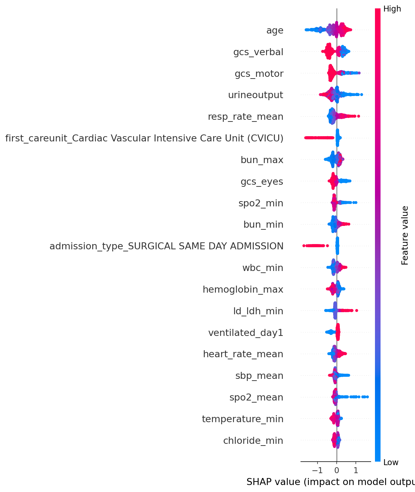
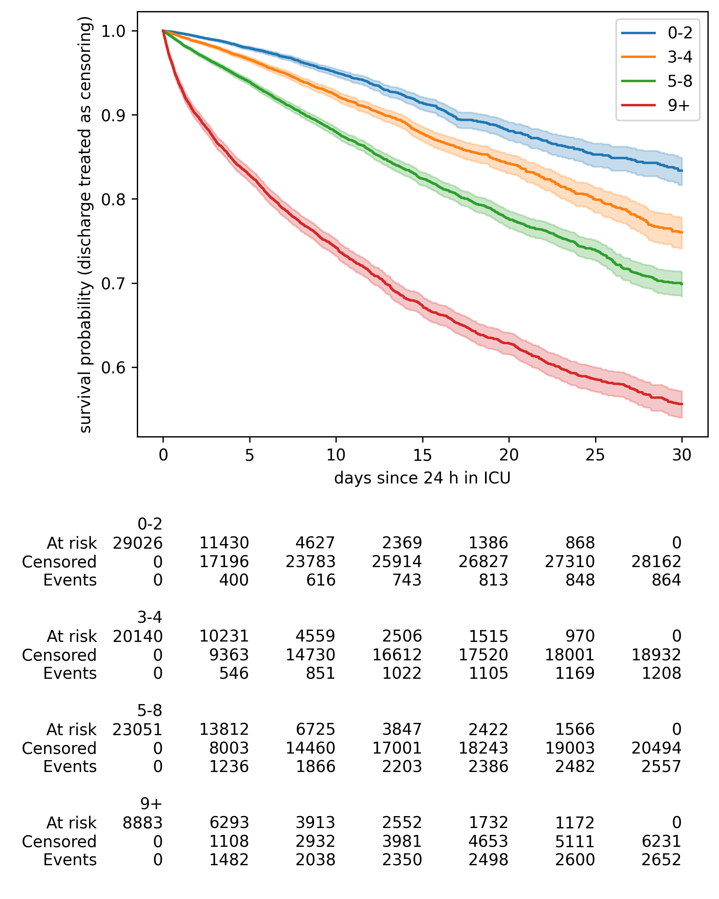
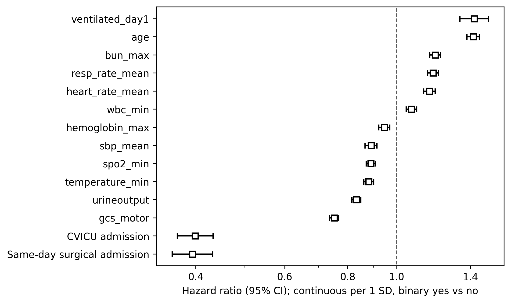

# MIMIC-IV ICU Mortality Prediction

A clinical machine learning pipeline for predicting in-hospital mortality of ICU patients using real-world MIMIC-IV data, built with XGBoost and SHAP.

## Dataset

[MIMIC-IV v3.1](https://physionet.org/content/mimiciv/) — a restricted-access clinical database containing 94,458 ICU stays at Beth Israel Deaconess Medical Center. Access requires PhysioNet credentialing and CITI human research training.

## Notebook

[View Notebook](https://github.com/Adyan213/MIMIC-IV-Mortality-Prediction/blob/main/mimic-iv-mortality-prediction.ipynb)

## Pipeline

- Features extracted via SQL on Google BigQuery, joining 8 clinical tables
- Dropped 32 features with >70% missing values
- Median imputation for numerical features, mode for categorical
- One-hot encoding for low cardinality categoricals, label encoding for race
- Class imbalance handling via scale_pos_weight (88% survived, 12% died)
- Removed SOFA composite scores to test raw feature predictiveness

## Models

### Logistic Regression (Baseline)

| Metric | Score |
|---|---|
| AUC-ROC | 0.888 |
| Died Recall | 79% |
| Died Precision | 37% |
| Macro F1 | 0.69 |

### XGBoost (No SOFA Scores, No LOS)

| Metric | Score |
|---|---|
| AUC-ROC | 0.909 |
| Died Recall | 76% |
| Died Precision | 46% |
| Macro F1 | 0.74 |

## Key Finding

In the original run, removing SOFA composite organ-failure scores did not degrade
AUC-ROC, suggesting tree-based models learn organ-failure patterns from raw vitals
and labs (consistent with the WiDS Datathon 2020 project). A later audit found that
ICU length of stay (`los`) had been included as a feature; it is only known after the
stay ends, so it leaks the outcome. Removing it lowered AUC-ROC from 0.918 to 0.909,
and 0.909 is the reported figure.

## SHAP Analysis

SHAP values confirm the model learned clinically coherent patterns:

- Age — older patients have significantly higher mortality risk
- GCS components — low consciousness level strongly associated with mortality
- Urine output — low output indicates kidney failure
- Respiratory rate — elevated rate indicates respiratory distress
- Ventilation on day 1 — mechanical ventilation indicates severe illness
- Surgical same-day admission — strongest protective factor, planned procedures indicate healthier baseline

## Survival analysis (in-hospital mortality)

As an extension of the classification model, I added a time-to-event analysis
(Kaplan-Meier and Cox proportional hazards, `lifelines`) on a cohort rebuilt from
scratch in BigQuery.

### Cohort

MIMIC-IV v3.1, **first ICU stay per admission**, with a **24-hour landmark**
(features are first-day aggregates, so follow-up starts at hour 24) and
**30-day administrative censoring**. Discharge alive is treated as censoring.

- 81,100 admissions (62,460 patients), 7,281 in-hospital deaths (9.0%)
- Before restricting to first stays, 4,481 of 94,458 ICU stays (4.7%) ended within
  24 h, including 2,044 of 11,350 in-hospital deaths (18.0%). Results therefore
  describe patients who survive the first ICU day.
- Data quality: 14 stays lack ICU outtime/LOS and were retained (neither is used).
  For deaths with a missing death time, discharge time was used.
- Repeated admissions by the same patient are handled with clustered standard errors.

### Leakage fix

ICU length of stay (`los`) was removed from the XGBoost classifier because it is only
known at the end of the stay. AUC-ROC: 0.918 with `los`, **0.909 without**.

### Kaplan-Meier

Overall survival at day 7 / 14 / 30: 0.922 / 0.847 / 0.718.

*Survival by day-1 SOFA group (0-2, 3-4, 5-8, 9+; n = 29,026 / 20,140 / 23,051 / 8,883).
Curves are ordered by severity (log-rank chi-square = 2,810, 3 df, p < 0.001).
Crude 30-day in-hospital death proportions: 3.0% / 6.0% / 11.1% / 29.9%.*

Because discharge is treated as censoring, Kaplan-Meier **understates absolute
survival** (the 9+ curve ends near 0.56, while 29.9% of that group died). The curves
are best used to compare groups; absolute risk would need a cumulative-incidence
(Aalen-Johansen) estimate, which is future work.

### Cox proportional hazards

14 covariates chosen from the retrained SHAP ranking. Patient-wise 80/20 split
(train 64,699 / test 16,401 admissions). Preprocessing: log1p on urine output, BUN
and WBC; winsorized at the 0.5th and 99.5th training percentiles; median imputation;
standardization of continuous variables. Penalizer 0.01. **Held-out concordance: 0.807.**

| Covariate | HR (95% CI) |
|---|---|
| Age | 1.42 (1.38-1.46) |
| GCS motor | 0.75 (0.74-0.77) |
| Urine output (log) | 0.83 (0.81-0.85) |
| Respiratory rate (mean) | 1.18 (1.15-1.21) |
| BUN max (log) | 1.19 (1.16-1.22) |
| SpO2 min | 0.89 (0.87-0.91) |
| WBC min (log) | 1.07 (1.04-1.09) |
| Hemoglobin max | 0.94 (0.92-0.97) |
| Heart rate (mean) | 1.16 (1.13-1.19) |
| Systolic BP (mean) | 0.89 (0.87-0.91) |
| Temperature min | 0.88 (0.86-0.90) |
| Ventilated on day 1 | 1.42 (1.33-1.52) |
| CVICU admission | 0.40 (0.37-0.43) |
| Same-day surgical admission | 0.39 (0.36-0.43) |

*Continuous variables: hazard ratio per 1 SD. Binary variables: yes vs no.
All estimates are adjusted associations, not causal effects. CVICU and same-day
surgical admissions likely reflect patient selection (planned, lower-risk cases).*

### Proportional-hazards check

Schoenfeld-residual tests on a 10,000-patient subsample. `gcs_motor` shows a clear
violation: its protective association is strongest early and weakens later in the
stay. Urine output, heart rate, respiratory rate and SpO2 show weaker evidence. Their
hazard ratios should be read as time-averaged effects over the 30-day window.

### Limitations

- Discharge is a competing event; Kaplan-Meier and Cox treat it as censoring.
- Only first-day features; no time-varying covariates.
- First ICU stay per admission only; single-centre data (Beth Israel Deaconess).
- Hazard ratios for variables that violate proportional hazards are averages.

### Future work

Aalen-Johansen cumulative incidence by SOFA group; Cox models split by time window
(days 0-7 vs later); time-varying covariates; retraining the deployed risk app
without `los`.

## Related Projects

[WiDS Datathon 2020 ICU Mortality Prediction](https://github.com/Adyan213/WiDS-Datathon-2020-Mortality-Prediction) — a related project on a pre-packaged clinical dataset showing consistent findings across APACHE score removal

## Tech Stack

Python, XGBoost, scikit-learn, SHAP, pandas, Google BigQuery, SQL, lifelines
